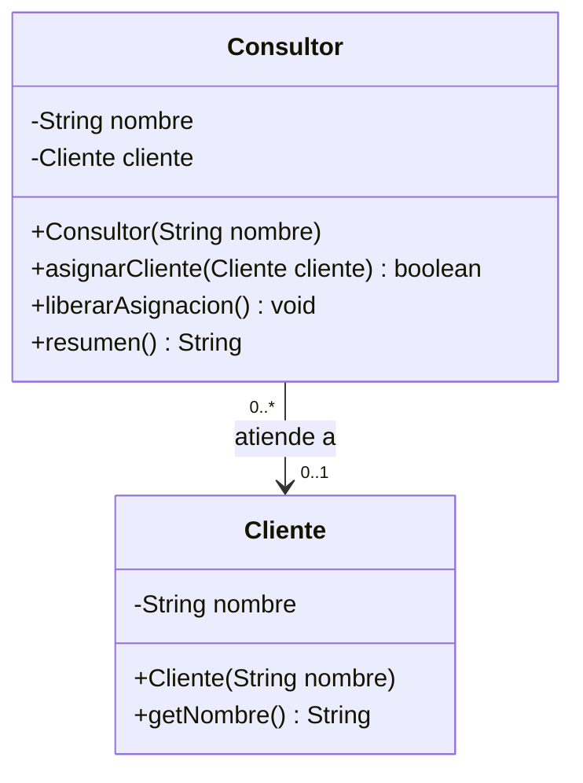
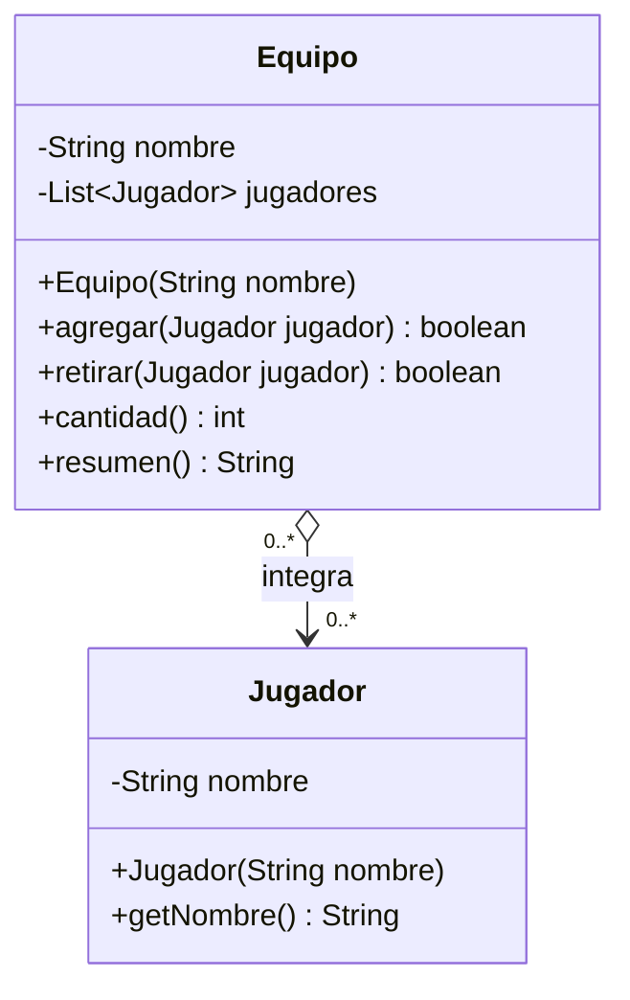
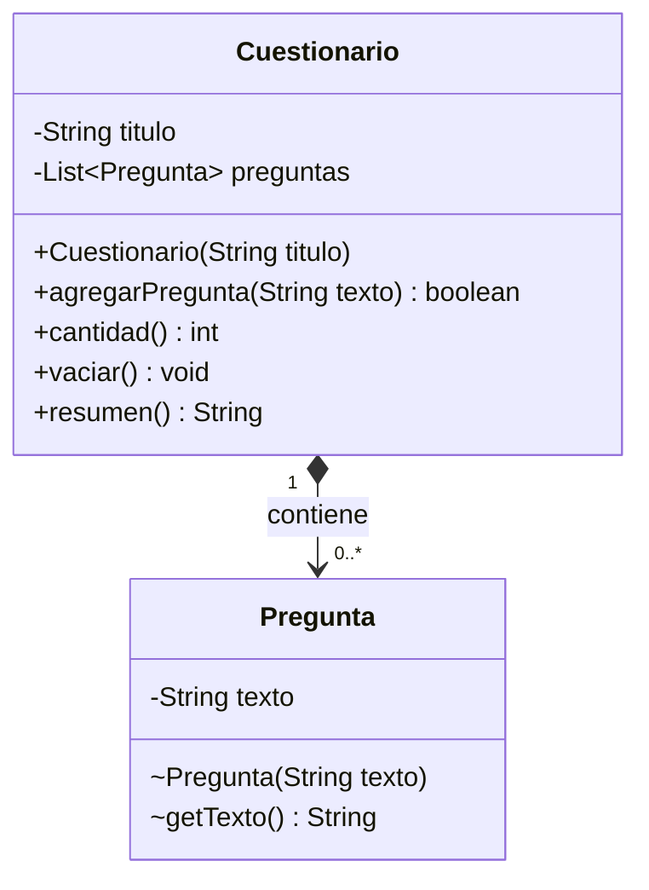
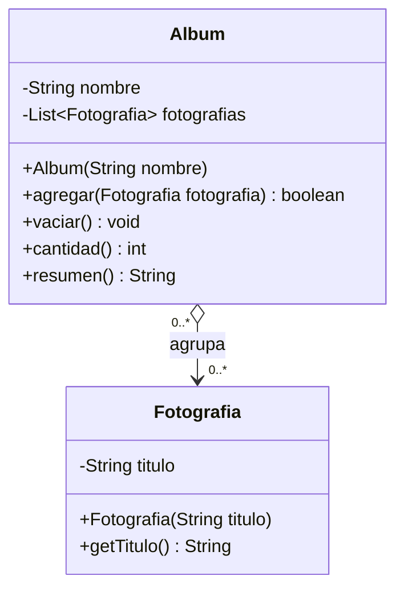
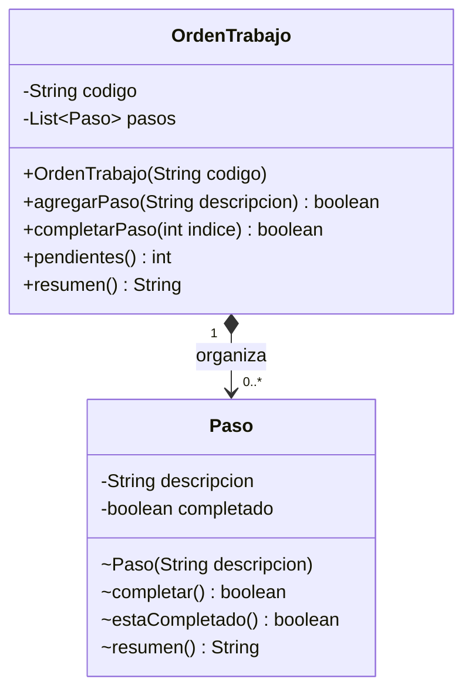

# Informe de Laboratorios · Sesión 09: Relaciones entre Clases

Este documento consolida la investigación conceptual sobre relaciones en UML y el análisis detallado de diseño orientado a objetos para los cinco laboratorios prácticos de la sesión.

---

## 1. Investigación Común Inicial: Relaciones en UML

En el modelado orientado a objetos con UML (*Unified Modeling Language*), las relaciones estructurales entre clases definen cómo interactúan los objetos, sus dependencias y el ciclo de vida de los mismos.

### 1.1. Asociación
- **Definición:** Es una relación estructural genérica que describe una conexión o vínculo entre instancias de clases. Un objeto colabora con otro enviándole mensajes o manteniendo una referencia a él ("conoce a" o "usa a").
- **Navegabilidad:** Si la relación es navegable solo en un sentido, se dibuja con una línea continua terminada en flecha abierta (`-->`); si es bidireccional, se usa una línea continua sin flechas o con flechas en ambos extremos.

### 1.2. Agregación (Compartida / Débil)
- **Definición:** Es una variante especializada de la asociación que modela una relación **todo–parte** ("tiene un" / *has-a*), donde los objetos que actúan como "partes" tienen existencia y ciclo de vida independientes del objeto "todo".
- **Características clave:** Las partes pueden existir antes de que se cree el todo, pueden ser compartidas simultáneamente por múltiples todos y, si el todo se destruye o vacía, las partes continúan vivas y válidas en el sistema.
- **Notación UML:** Línea continua con un **rombo hueco/blanco** en el extremo adyacente a la clase que representa el **todo** (`o--`).

### 1.3. Composición (Compuesta / Fuerte)
- **Definición:** Es una forma estricta de agregación que representa una relación **todo–parte con pertenencia exclusiva y ciclo de vida coincidente**.
- **Características clave:** Cada parte pertenece a un único todo a la vez (multiplicidad `1` o `0..1` en el extremo del contenedor). El todo es responsable directo de la creación, gestión y destrucción de sus partes. Si el todo deja de existir o se vacía, sus partes dejan de tener vigencia y propósito en el modelo de dominio.
- **Notación UML:** Línea continua con un **rombo relleno/negro** en el extremo adyacente a la clase que representa el **todo** (`*--`).

### 1.4. Multiplicidad y Navegabilidad
- **Multiplicidad:** Especifica la cardinalidad permitida en cada extremo de la relación:
  - `1`: Exactamente una instancia obligatoria.
  - `0..1`: Cero o una instancia (opcional).
  - `*` o `0..*`: Cero o muchas instancias.
  - `1..*`: Una o muchas instancias (al menos una obligatoria).
- **Fuentes consultadas:**
  - *OMG Unified Modeling Language (OMG UML) Superstructure Version 2.5.1*, Object Management Group. Disponible en: [https://www.omg.org/spec/UML/](https://www.omg.org/spec/UML/)
  - *Fowler, Martin (2003). UML Distilled: A Brief Guide to the Standard Object Modeling Language (3rd Edition)*, Addison-Wesley.

---

## 2. Lab 01 · Consultor y Cliente

### Diagrama de Clases UML

### Clasificación y Justificaciones
- **Clasificación:** **Asociación Simple (Unidireccional)**.
- **¿Existe un todo–parte significativo?**
  No. Un cliente no es una pieza ni un componente estructural de un consultor, ni el consultor funciona como un contenedor agregado. Son dos entidades autónomas del negocio que establecen un vínculo de atención o servicio temporal.
- **¿Puede compartirse la misma instancia?**
  Sí. En el código de prueba (`S09Lab01Main`), la misma instancia `tienda` (`Cliente`) es asignada simultáneamente tanto al consultor `ana` como al consultor `luis` (`ana.asignarCliente(tienda)` y `luis.asignarCliente(tienda)`).
- **¿Qué evidencia del contexto y del código sostiene la clasificación?**
  En `Consultor.java`, el cliente se recibe por parámetro en `asignarCliente(Cliente cliente)` y el método `liberarAsignacion()` desconecta el enlace asignando `cliente = null`. Al hacerlo con `ana`, la instancia `tienda` continúa existiendo, vinculada a `luis` y accesible directamente (`tienda.getNombre()`). La navegabilidad es estrictamente unidireccional porque `Cliente` no almacena referencias a `Consultor`.

### Variación Conceptual
> *Una política nueva exige que todo consultor nazca con un cliente y nunca pueda quedar sin asignación. ¿Qué cambiaría en la multiplicidad?*

**Respuesta:** La multiplicidad en el extremo de `Cliente` cambiaría de `0..1` a `1` (obligatoria), lo que obligaría a recibir y validar el `Cliente` directamente en el constructor de `Consultor` y eliminar el método `liberarAsignacion()`.

---

## 3. Lab 02 · Equipo y Jugadores

### Diagrama de Clases UML

### Clasificación y Justificaciones
- **Clasificación:** **Agregación (Compartida / Débil)**.
- **¿Existe un todo–parte significativo?**
  Sí. Conceptualmente el `Equipo` representa una entidad colectiva (el "todo") conformada por múltiples miembros independientes que son sus partes integrantes (`Jugador`).
- **¿Puede compartirse la misma instancia?**
  Sí. La misma instancia de jugador `sara` es agregada y pertenece simultáneamente a dos equipos diferentes: `azul` y `rojo`.
- **¿Qué evidencia del contexto y del código sostiene la clasificación?**
  Las instancias de `Jugador` se crean de forma autónoma antes de los equipos (`new Jugador(...)`), se inyectan por referencia al `Equipo` mediante `agregar(Jugador)`, y al retirar a `sara` del equipo azul (`azul.retirar(sara)`), la instancia no se destruye ni se invalida: sigue formando parte del equipo rojo y disponible como objeto individual.

### Variación Conceptual
> *La organización prohíbe que un jugador esté en dos equipos simultáneamente. ¿Qué multiplicidad y qué control habría que cambiar?*

**Respuesta:** La multiplicidad en el extremo de `Equipo` cambiaría de `0..*` a `0..1`, requiriendo incorporar un mecanismo de control previo (por ejemplo, validar un registro central de pertenencia o un atributo de equipo actual en el jugador) para rechazar la incorporación si el jugador ya está fichado por otro equipo.

---

## 4. Lab 03 · Cuestionario y Preguntas

### Diagrama de Clases UML

### Clasificación y Justificaciones
- **Clasificación:** **Composición (Fuerte / Pertenencia Exclusiva)**.
- **¿Existe un todo–parte significativo?**
  Sí. Las preguntas son componentes intrínsecos e inseparables del cuestionario específico; no tienen propósito ni identidad autónoma fuera de la evaluación a la que pertenecen.
- **¿Puede compartirse la misma instancia?**
  No. Las preguntas tienen pertenencia exclusiva. La clase `Pregunta` tiene visibilidad de paquete (`class Pregunta`) y constructor de paquete, impidiendo que el cliente externo instancie preguntas directamente o las comparta entre distintos cuestionarios.
- **¿Qué evidencia del contexto y del código sostiene la clasificación?**
  `Cuestionario` controla de forma absoluta el ciclo de vida de `Pregunta`: el método `agregarPregunta(String texto)` recibe un simple `String` y realiza internamente `new Pregunta(texto.strip())`. La lista interna nunca se expone y, al invocar `vaciar()`, las instancias de preguntas pierden su contenedor y dejan de existir en el dominio del sistema.

### Variación Conceptual
> *Ahora existe un banco externo de preguntas reutilizables y los cuestionarios reciben esas referencias. ¿Qué decisión de propiedad o relación habría que reconsiderar?*

**Respuesta:** La relación dejaría de ser composición y se transformaría en una **agregación**, puesto que las preguntas adquirirían un ciclo de vida independiente del cuestionario, permitiendo que una misma pregunta sea referenciada y compartida por múltiples cuestionarios (multiplicidad `0..*` a `0..*`).

---

## 5. Lab 04 · Álbum y Fotografías

### Diagrama de Clases UML

### Clasificación y Justificaciones
- **Clasificación:** **Agregación (Compartida / Débil)**.
- **¿Existe un todo–parte significativo?**
  Sí. El `Album` constituye un todo contenedor o agrupador que reúne partes independientes, que son las `Fotografia`.
- **¿Puede compartirse la misma instancia?**
  Sí. La misma fotografía `playa` (`new Fotografia("Playa")`) se añade simultáneamente al álbum `vacaciones` y al álbum `favoritas`.
- **¿Qué evidencia del contexto y del código sostiene la clasificación?**
  Las fotografías se instancian externamente con antelación a los álbumes, se incorporan por referencia y, cuando se invoca `vacaciones.vaciar()`, la colección interna del álbum se limpia (`clear()`), pero la fotografía `playa` sigue existiendo intacta en el álbum `favoritas` y en su variable original sin verse alterada.

### Variación Conceptual
> *El sistema cambia a imágenes internas de una ficha que no pueden reutilizarse ni obtenerse desde fuera y se crean al recibir sus datos. ¿Qué tendrías que revisar para clasificarlas?*

**Respuesta:** Se debería revisar la exclusividad del ciclo de vida y la encapsulación; al no poder compartirse, crearse internamente por la ficha a partir de datos primitivos y depender totalmente de la existencia de la ficha contenedora, la relación pasaría a clasificarse como **composición**.

---

## 6. Lab 05 · Orden de Trabajo y Pasos

### Diagrama de Clases UML

### Clasificación y Justificaciones
- **Clasificación:** **Composición (Fuerte / Pertenencia Exclusiva)**.
- **¿Existe un todo–parte significativo?**
  Sí. Cada `Paso` es una etapa que forma parte exclusiva del flujo operativo de una orden de trabajo puntual.
- **¿Puede compartirse la misma instancia?**
  No. La clase `Paso` maneja un estado mutable contextual (`completado`). Si un paso fuera compartido entre órdenes, completar una tarea en `OT-01` alteraría ilegítimamente el estado de `OT-02`. Por ello, cada paso pertenece exclusivamente a su orden.
- **¿Qué evidencia del contexto y del código sostiene la clasificación?**
  `OrdenTrabajo` es la única que instancia sus pasos mediante `agregarPaso(String descripcion)` haciendo `new Paso(...)`. Las operaciones se realizan por delegación usando el índice (`completarPaso(int indice)`). No existen métodos para inyectar pasos externos ni para extraer las instancias de `Paso`, garantizando un encapsulamiento rígido y ciclo de vida exclusivo.

### Variación Conceptual
> *Se introduce un catálogo de tareas reutilizables que varias órdenes pueden consultar. ¿Conviene reutilizar el mismo Paso con su estado completado o separar la descripción de tarea del paso de cada orden? Explica en una frase.*

**Respuesta:** Conviene desacoplar la definición inmutable de la tarea (catálogo) de la instancia de paso en la orden, de modo que el estado mutable `completado` permanezca como responsabilidad exclusiva e independiente de cada orden de trabajo.

---

## 7. Matriz Comparativa Resumen (Sesión 09)

| Lab | Todo / Contenedor | Parte / Componente | Tipo de Relación | Multiplicidad | Ciclo de Vida |
|---|---|---|---|---|---|
| **01** | `Consultor` | `Cliente` | **Asociación** | `0..*` a `0..1` | Independiente (el cliente no es parte) |
| **02** | `Equipo` | `Jugador` | **Agregación** | `0..*` a `0..*` | Independiente (jugador compartido) |
| **03** | `Cuestionario` | `Pregunta` | **Composición** | `1` a `0..*` | Dependiente y exclusivo del cuestionario |
| **04** | `Album` | `Fotografia` | **Agregación** | `0..*` a `0..*` | Independiente (foto compartida) |
| **05** | `OrdenTrabajo` | `Paso` | **Composición** | `1` a `0..*` | Dependiente y exclusivo de la orden |
