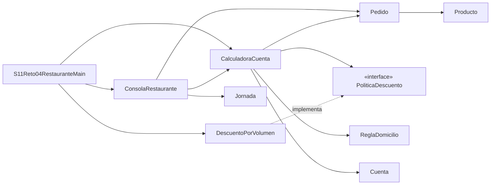

# Reto 4 · Restaurante · Refactorización con SOLID (Sesión 11)

**Punto de partida:** `S03Reto04Restaurante.java` (sesión 3), un único `main` de ~230 líneas.
**Resultado:** paquete `s11reto04` con el mismo comportamiento y un punto de variación para el descuento.

---

## 1. Diagnóstico (antes de mover código)

En la versión original todo vivía en `main`: precios (`final long`), menú impreso a mano, `Scanner`, `switch` de producto, acumuladores, descuento, domicilio, resumen y jornada.

| Responsabilidad | Ubicación original |
| --- | --- |
| Menú | `System.out.println("1 = Hamburguesa, 18000 pesos")…` dentro del `do-while` |
| Acumulación | `switch (opcion)` + `subtotal += …`, `cantPizza += …` |
| Descuento | `if (subtotal > 150000) … else if (subtotal > 100000)` |
| Domicilio | `if (neto < 30000)` |
| Cuenta final | `total = neto + domicilio` + bloque de impresión |

### Dos cambios que hoy eran costosos

1. **Cambiar el texto del menú o un precio:** el precio estaba duplicado en la constante **y** en el texto impreso, y el `switch` también repetía el nombre. Había que editar el mismo método donde se calcula la cuenta.
2. **Cambiar solo la política de descuento** (p. ej. una promoción): obligaba a editar el mismo `main` que lee el teclado, acumula productos y calcula domicilio. Riesgo de romper el orden del cálculo o el domicilio; imposible probar el descuento sin teclear un pedido.

Ambas peticiones tocaban el **mismo archivo y el mismo método**.

---

## 2. Diseño resultante



| Archivo | Responsabilidad (motivo de cambio) |
| --- | --- |
| `Producto.java` | Catálogo (enum): opción, nombre y precio (cambia si cambia el menú). |
| `Pedido.java` | Estado del pedido con `HashMap<Producto, Long>`: cantidades, unidades, subtotal. Rechaza cantidades ≤ 0 sin modificarse. |
| `PoliticaDescuento.java` | Interfaz con contrato mínimo: `long calcularDescuento(long subtotal)`. |
| `DescuentoPorVolumen.java` | Regla comercial original 15 % / 10 % / 0. |
| `ReglaDomicilio.java` | 5000 si **neto** < 30000; pedido vacío = 0. |
| `Cuenta.java` | Clase con atributos `final` y getters: unidades, subtotal, descuento, neto, domicilio y total. |
| `CalculadoraCuenta.java` | Arma la cuenta en orden fijo: subtotal → descuento → neto → domicilio → total. |
| `Jornada.java` | Acumulados de la jornada (extensión de la sesión 3). |
| `ConsolaRestaurante.java` | Captura (`Scanner`) y presentación. Único lugar con textos; son los mismos de la sesión 3. |
| `S11Reto04RestauranteMain.java` | Ensambla objetos e inyecta la política. |
| `S11Reto04PruebasRegresion.java` | Pruebas sin JUnit. |
| `DescuentoFijoPrueba.java` / `DescuentoInvalidoPrueba.java` | Colaboradores **solo para pruebas** (uno cumple el contrato, otro lo viola a propósito). Main no los usa. |

**Herramientas usadas:** solo lo visto hasta la sesión 10 más las interfaces de esta sesión: clases, objetos, `enum`, `interface`, `HashMap`, excepciones (`IllegalArgumentException`, `IllegalStateException`). Sin `record`, lambdas ni referencias a métodos.

**Tipos:** la cantidad que se ingresa es `int` (entero positivo); todo el dinero y todas las acumulaciones (subtotal, unidades, vendidos por producto, recaudado) son `long`.

**Decisión de domicilio conservada:** se evalúa sobre el **neto** (igual que en la sesión 3). Con los precios y umbrales actuales da el mismo resultado que sobre el subtotal, porque el descuento empieza en 100000; sobre el neto protege el margen si una promoción futura dejara el neto por debajo de 30000.

---

## 3. Principio → problema → cambio → beneficio

| Principio | Problema | Cambio | Beneficio |
| --- | --- | --- | --- |
| **SRP** | `main` capturaba, calculaba, acumulaba e imprimía. | Separados: `Pedido` (estado), `CalculadoraCuenta` (reglas), `ConsolaRestaurante` (E/S), `Producto` (catálogo). | Cambiar el texto del menú solo toca `ConsolaRestaurante`/`Producto`; el cálculo no cambia. |
| **OCP** | Una nueva promoción obligaba a reescribir el `if/else` dentro del cálculo. | `CalculadoraCuenta` usa `PoliticaDescuento` sin conocer variantes. | Nueva promoción = nueva clase + una línea en Main; `CalculadoraCuenta` y `Pedido` no se tocan. |
| **LSP** | No existía contrato; cualquier regla podía devolver negativos o sumar domicilio. | Contrato documentado: `0 ≤ descuento ≤ subtotal`, `0` para subtotal 0, sin tocar productos ni domicilio. `CalculadoraCuenta` lanza `IllegalStateException` si una variante lo viola. | Cualquier política aceptada es intercambiable sin sorpresas. |
| **ISP** | — (riesgo de una interfaz "universal"). | La interfaz tiene **un solo método**. No imprime menú, no registra clientes, no despacha. | Ninguna implementación necesita métodos vacíos. |
| **DIP** | El cálculo dependía de la regla concreta y del `Scanner` en el mismo método. | `Main` crea `DescuentoPorVolumen` y lo inyecta por constructor; `CalculadoraCuenta` no conoce `Scanner`. | Se prueba la cuenta con un colaborador controlado, sin teclado. |

**Lo que no se hizo a propósito:** `ReglaDomicilio` **no** es interfaz. Hoy no hay una variación real del domicilio; crear una interfaz solo para "completar las cinco letras" añadiría indirección sin beneficio. Si apareciera (p. ej. tarifa por zona), se extraería entonces.

**Texto del descuento:** la política solo promete un **importe**, no un porcentaje. Para conservar el mensaje original ("Aplica 15%" / "Aplica 10%"), la consola calcula el porcentaje **efectivo** a partir del resultado (`descuento * 100 / subtotal`). Es solo presentación: no conoce cómo calcula la política.

### Costo y alternativa más simple considerada

- **Alternativa más simple:** dejar el `if/else` del descuento como método `static` dentro de `CalculadoraCuenta`, sin interfaz. Es más corto y suficiente si nunca cambia la promoción, pero obliga a editar la calculadora (y volver a probarla) para cada promoción nueva.
- **Costo del diseño elegido:** pasamos de 1 archivo a 9 clases de programa (más 3 de prueba). Para seguir el flujo hay que saltar entre archivos. Se aceptó porque cada clase tiene un motivo de cambio claro y el cálculo ahora se prueba sin teclado.

---

## 4. Pruebas de regresión (antes / después)

"Antes" = resultados de la sesión 3 (tabla de su README). "Después" = `S11Reto04PruebasRegresion`.

| Productos | Unidades | Subtotal | Descuento | Domicilio | Total | Antes | Después |
| --- | --- | --- | --- | --- | --- | --- | --- |
| Bebida × 1 | 1 | 6000 | 0 | 5000 | 11000 | ✅ | ✅ |
| Ensalada × 2 | 2 | 30000 | 0 | 0 | 30000 | ✅ | ✅ |
| Pizza × 4 | 4 | 100000 | 0 | 0 | 100000 | ✅ | ✅ |
| Pizza × 6 | 6 | 150000 | 15000 | 0 | 135000 | ✅ | ✅ |
| Pizza × 7 | 7 | 175000 | 26250 | 0 | 148750 | ✅ | ✅ |
| Hamburguesa × 4 y pizza × 2 | 6 | 122000 | 12200 | 0 | 109800 | ✅ | ✅ |
| Finalizar inmediatamente | 0 | 0 | 0 | 0 | 0 | ✅ | ✅ |
| Opción 7 | — | sin cambios | | | | ✅ | ✅ |
| Cantidad −2 | — | sin cambios | | | | ✅ | ✅ |

Pruebas adicionales:

- **Límites de la política original:** 0, 6000, 100000 → 0; 100001 → 10000; 150000 → 15000; 150001 → 22500; 175000 → 26250. Todas en el rango `0..subtotal`.
- **Colaborador controlado** (`DescuentoFijoPrueba`, descuento fijo de 2000): Ensalada × 2 → neto 28000 → domicilio 5000 → total 33000. Prueba el **armado** de la cuenta (domicilio después del descuento), no sustituye las pruebas de la política comercial.
- **Política que viola el contrato** (`DescuentoInvalidoPrueba`, devuelve `subtotal + 1`): detectada con `IllegalStateException`.

Salida obtenida: `Resultado: 12 aprobadas, 0 fallidas`.

**Comparación de salida completa:** se ejecutaron `S03Reto04Restaurante` (sesión 3) y `S11Reto04RestauranteMain` con la **misma entrada** (varios clientes, pedido vacío, opción 7, cantidad −2, límites 150000 y 175000, pedido mixto). Ambas producen 229 líneas y la comparación línea por línea (`Compare-Object`) no encontró diferencias: **salida idéntica**.

---

## 5. Conectar una promoción futura

Ejemplo: "descuento fijo de 10000 en pedidos > 200000".

| Archivo | ¿Cambia? |
| --- | --- |
| `PromocionNueva.java` (nuevo, implementa `PoliticaDescuento`) | ➕ Se crea |
| `S11Reto04RestauranteMain.java` | ✏️ Una línea: qué política se inyecta |
| `CalculadoraCuenta.java`, `Pedido.java`, `Producto.java`, `ReglaDomicilio.java`, `Cuenta.java`, `ConsolaRestaurante.java`, `PoliticaDescuento.java`, `DescuentoPorVolumen.java` | ✅ Estables |

La promoción debería probarse **aparte**, sin reemplazar las pruebas de `DescuentoPorVolumen`, y documentarse como requisito nuevo. No se implementó porque el reto pide conservar las reglas originales.

---

## 6. Compilación y ejecución

Desde la carpeta `reto-04-restaurante`:

```bash
javac s11reto04/*.java
java s11reto04.S11Reto04PruebasRegresion   # pruebas
java s11reto04.S11Reto04RestauranteMain    # programa interactivo
```

